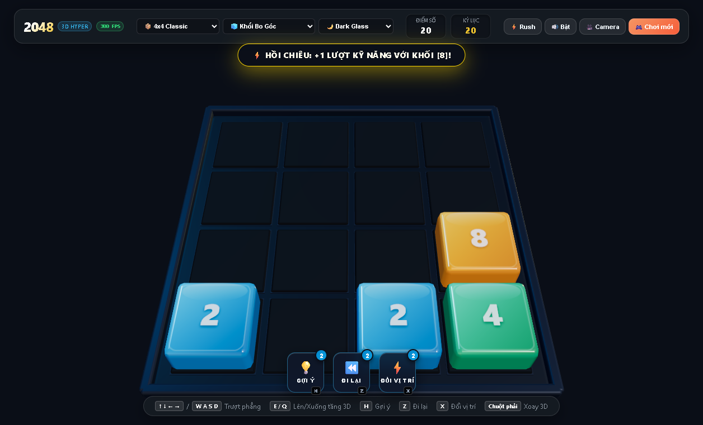

# 🎮 3D 2048 & Hypercube — WebGL Three.js & GSAP



Tựa game **3D 2048 & 3x3x3 Hypercube** hoàn chỉnh, chạy thuần WebGL với Three.js và GSAP, đạt hiệu năng cực cao **~300 FPS** trên trình duyệt hiện đại.

---

## 🌟 Tính Năng Nổi Bật

### 1. Phép Bổ Trợ (Summoner Spells kiểu LMHT)
- **💡 Gợi ý (Hint) [Phím H]:** Thuật toán Heuristic thông minh phân tích bàn cờ, dự đoán nước đi tối ưu nhất và thông báo cho người chơi.
- **⏪ Đi lại (Undo) [Phím Z / U]:** Hoàn tác lại nước đi vừa rồi, khôi phục lại toàn bộ bàn cờ 3D và điểm số.
- **⚡ Đổi vị trí (Swap / Flash) [Phím X]:** Dịch chuyển hoán đổi vị trí giữa 2 ô bất kỳ trên bàn cờ bằng thao tác bấm chuột trực tiếp vào khối 3D!
- **⚡ Cơ chế Hồi Chiêu (Recharge):** Khởi đầu với 2 lượt cho mỗi kỹ năng (`2/2`). Mỗi khi người chơi gộp tạo ra một **ô kỷ lục mới** trong ván (8, 16, 32, 64, 128, 256, 512, 1024, 2048...), tất cả các kỹ năng lập tức được **+1 lượt hồi chiêu**!

### 2. Hai Chế Độ Bàn Cờ 3D
- **4x4 Classic:** Bàn cờ phẳng truyền thống với các khối số keycap 3D dày dặn, bo tròn góc cạnh, số in nổi ở mặt trên (+Y) và 4 mặt hông trơn láng bóng bẩy.
- **3x3x3 Hypercube (Lồng không gian 3 chiều):**
  - Gồm 3 tầng x 3 hàng x 3 cột = **27 ô không gian**.
  - Khung lồng 3D xuyên thấu tinh tế, vách ngăn tầng phát sáng.
  - Hỗ trợ di chuyển **6 hướng thực sự**:
    - Ngang: `W / A / S / D` hoặc phím mũi tên `↑ / ↓ / ← / →`.
    - Trục Y (Tầng): Phím `E` / `Space` để đẩy khối lên tầng trên; phím `Q` / `Shift` để ép khối xuống tầng dưới.

### 3. Chế Độ "Time Rush" & Khối Bom Đếm Ngược
- Đồng hồ đếm ngược `30.0s` với thanh tiến trình đổi màu theo thời gian thực (Xanh -> Vàng -> Đỏ khẩn cấp).
- Gộp khối để cộng thêm thời gian (`+0.8s` đến `+4.0s`).
- Khối bom xuất hiện mỗi 6 lượt đi: phải gộp nó trước khi đếm về 0 để tránh bị nổ tung và trừ `-5.0s`.

### 4. Tùy Biến 4 Hình Dạng Khối 3D (Tile Shapes)
- 🧊 **Khối Bo Góc (Rounded Cube):** Phong cách phím cơ Keycap cao cấp.
- 💎 **Bát Diện Kim Cương (Crystal Octahedron):** Khối bát diện tự xoay với lõi phát sáng.
- 🔮 **Cầu Năng Lượng (Core Sphere):** Khối cầu với vành đai kép nghiêng 45° quay quanh.
- 🧬 **Tiến Hóa (Auto-Evolution):** Tự động đổi hình dáng theo giá trị số (`2-16` -> `32-128` -> `256+`).

### 5. 3 Bộ Giao Diện & Bản Đồ Hiệu Năng (Themes)
- 📊 **Performance Telemetry HUD:** Hiển thị biểu đồ FPS, Frame Time (ms), Draw Calls, Triangles, APM và Density.
- ⚡ **Hyper Neon Cyber:** Lưới sàn Synthwave, đèn màu PointLight động và hiệu ứng rung lắc Camera khi gộp lớn.
- 🌙 **Dark Glass:** Kính mờ sang trọng, tối giản.

---

## 🚀 Hướng Dẫn Chạy Cục Bộ

### Cách 1: Sử dụng Python (Không cần cài đặt thư viện)
```bash
python server.py
```
Mở trình duyệt tại: **`http://localhost:3000`**

### Cách 2: Sử dụng Vite / Node.js
```bash
npm install
npm run dev
```

---

## 🛠️ Công Nghệ Sử Dụng
- **Three.js** (Core WebGL Rendering, Physical Materials, ACES Filmic Tone Mapping)
- **GSAP** (Smooth 3D Tweens, Camera Shake, Elastic Pops)
- **Web Audio API** (Procedural Synthesizer Sound Engine)
- **HTML5 Canvas 2D & CSS3 Glassmorphism** (Zero external heavy assets)
